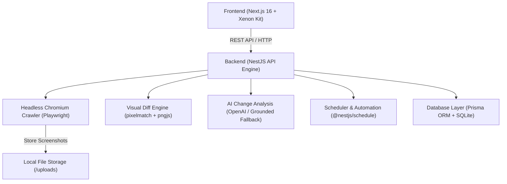

# AI Competitor Intelligence Platform

[](https://github.com/janismalhotra-29/competitor-intelligence/actions)


An enterprise-grade, autonomous competitor monitoring system that continuously tracks permitted public webpages, captures full-viewport visual snapshots, detects meaningful DOM and pixel-level changes, performs AI-powered change summarization, benchmarks competitor capabilities, and delivers real-time competitive intelligence through a modern **Xenon Design System** dashboard.

---

## 🌟 Key Capabilities & Features

### 1. 🤖 Autonomous Web Surveillance (Playwright Headless Chromium)
- Automated page crawling and full-resolution screenshot capture.
- SSRF (Server-Side Request Forgery) protection with private subnet and cloud metadata blocking (`validatePublicUrl`).
- `robots.txt` compliance checking and per-domain rate limiting.

### 2. 🔍 Pixel-Level Visual Diffing & Heatmap Engine (`pixelmatch`)
- Computes exact pixel alteration metrics and diff percentage between snapshots.
- Generates high-contrast visual difference heatmaps.
- Interactive **Before vs After Split-Curtain Slider** and side-by-side visual inspector.

### 3. 🧠 AI-Powered Change Analysis & Business Insights
- Grounded LLM pipeline (OpenAI GPT-4o / GPT-4o-mini with structured outputs).
- Analyzes DOM copy deltas, headline revisions, and navigation shifts.
- Classifies change significance (Low, Medium, High) with executive bullet summaries.

### 4. ⚡ AI Competitive Battlecard & Benchmarking Engine
- **Cross-Competitor Capability Matrix**: Side-by-side comparison table evaluating feature availability across all tracked competitors.
- **Velocity Leader**: Identifies which competitor iterates and deploys updates fastest.
- **Market Pricing Anchor**: Computes lowest entry pricing floor.
- **Executive Strategic Briefing**: Grounded market analysis synthesizing competitive velocity and transparency.
- **1-Click Export**: Generates complete executive battlecard report (`.md` format) for leadership presentations.

### 5. 💰 Automated Pricing Intelligence Extractor
- Discovers and parses pricing tiers (Plan name, billing period, rates, and feature breakdown).
- Cross-competitor comparison matrix table.
- Markdown Executive Intelligence Report export (`.md` download).

### 6. ⚡ Liquid Glass Command Palette (`⌘K` / `Ctrl+K`)
- Linear and Raycast-style keyboard-driven command bar.
- Instant domain filtering, tab navigation (`⌘B` for Battlecard), and instant crawl triggers.

### 7. 🎨 Streamlined Xenon UI Suite (`@xenon-kit/web`)
- Single-surface architecture adhering strictly to hairline borders and zero card nesting.
- Self-contained competitor cards with live status badges, human-readable insights, and 1-click actions.
- Real-time in-app notification center and alert trail with unread counter sync.

---

## 🏗️ Architecture & Tech Stack



| Layer | Technologies |
| :--- | :--- |
| **Frontend** | Next.js 16 (App Router), React 19, TypeScript, `@xenon-kit/web`, `@phosphor-icons/react` |
| **Backend** | NestJS 12, TypeScript, Express, `@nestjs/schedule`, `@nestjs/config` |
| **Database & ORM** | SQLite, Prisma ORM v5.14 |
| **Crawling & Images**| Playwright (Headless Chromium), `cheerio`, `pixelmatch`, `pngjs` |
| **AI / Intelligence** | OpenAI API (Zod structured output format), Grounded NLP fallback |
| **Testing** | Vitest v4 (76 unit tests, 13 test suites), ESLint |
| **DevOps** | Docker, Docker Compose, GitHub Actions CI |

---

## 🐳 Quickstart with Docker (Recommended)

Run the entire platform (Frontend, Backend, Database, and Headless Browser) with a single command:

```bash
# 1. Clone repository
git clone https://github.com/janismalhotra-29/competitor-intelligence.git
cd competitor-intelligence

# 2. Start services in Docker
docker compose up --build
```

* **Frontend Dashboard:** [http://localhost:3000](http://localhost:3000)
* **Backend API:** [http://localhost:3001](http://localhost:3001)
* **Health Check:** [http://localhost:3001/health](http://localhost:3001/health)

---

## 💻 Local Development Setup

### Prerequisites
* Node.js `>= 20.0.0`
* npm `>= 10.0.0`

### 1. Backend Setup
```bash
cd backend
npm install
npx prisma generate
npx prisma db push
npm run start:dev
```
Backend runs on **`http://localhost:3001`**.

### 2. Frontend Setup
```bash
cd frontend
npm install
npm run dev
```
Frontend runs on **`http://localhost:3000`**.

---

## 🧪 Testing & Quality Verification

All components have been verified against unit, integration, and security test suites:

- **Backend Unit Tests:** `76 / 76 passed (13 test suites)`
  ```bash
  cd backend && npm test
  ```
- **Frontend Type Safety:** `0 TypeScript errors`
  ```bash
  cd frontend && npx tsc --noEmit
  ```
- **Frontend Linter:** `0 ESLint errors`
  ```bash
  cd frontend && npm run lint
  ```
- **Production Build:** Statically prerendered with exit code 0
  ```bash
  cd frontend && npm run build
  ```

---

## 📁 Repository Structure

```text
├── backend/
│   ├── src/
│   │   ├── alerts/           # In-app notifications & webhook dispatchers
│   │   ├── automation/       # Scheduled recurring cron jobs
│   │   ├── battlecard/       # AI Competitive Battlecard & Benchmarking Engine
│   │   ├── change-detection/ # Heuristic & text diff algorithms
│   │   ├── common/           # SSRF validator, URL parser
│   │   ├── competitors/      # Domain registration & CRUD controllers
│   │   ├── crawler/          # Playwright & Cheerio web scraper
│   │   ├── pricing/          # Pricing plan extraction & markdown report generator
│   │   ├── screenshots/      # Pixelmatch image diff engine & storage controller
│   │   └── main.ts           # NestJS bootstrap with CORS
│   └── prisma/               # SQLite database schema
├── frontend/
│   ├── src/
│   │   ├── app/              # Next.js App Router (page.tsx, layout.tsx)
│   │   ├── components/
│   │   │   ├── alerts/       # Alerts dropdown & notification feed
│   │   │   ├── battlecard/   # CompetitiveBattlecard matrix, briefing & export
│   │   │   ├── changes/      # SnapshotDiffModal (Split slider, side-by-side, heatmap)
│   │   │   ├── dashboard/    # EasyCompetitorFeed, CommandPalette, MetricsRibbon
│   │   │   ├── diffs/        # VisualDiffGallery
│   │   │   └── pricing/      # PricingMatrix cross-competitor table
│   │   ├── hooks/            # Custom React hooks (useCompetitors, useAlerts)
│   │   └── lib/              # API client wrapper
└── README.md
```

---

## 📄 License
UNLICENSED — Private Academic / Enterprise Project.
